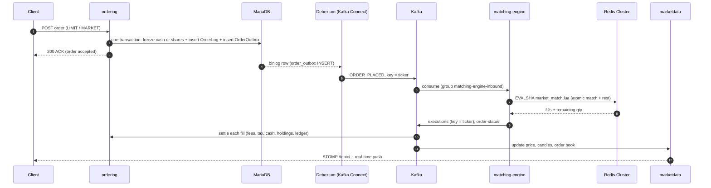
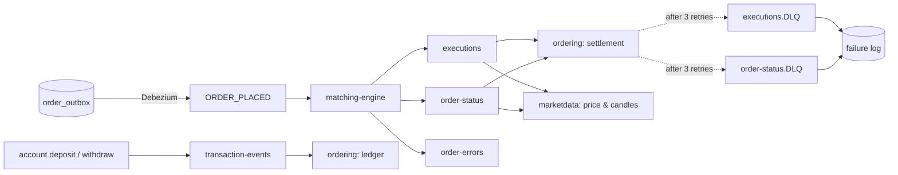
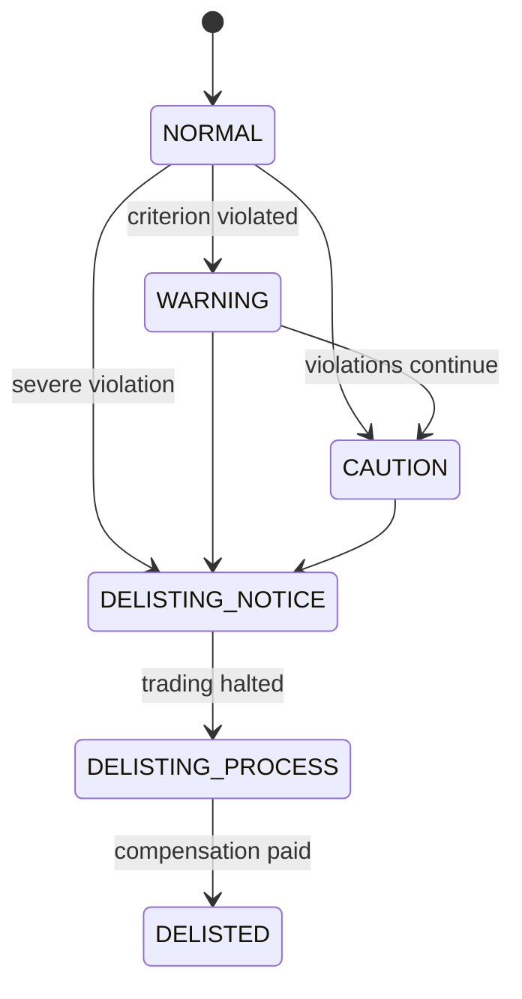

<div align="center">

# MKX — One Exchange Platform for Brokerages, Corporations, and Investors

### 🏆 1st Place, Final Project — Hanwha Systems BEYOND SW CAMP (Cohort 16) 🏆


</div>

## Overview

MKX is a **multi-tenant B2B digital securities exchange**. Small and mid-sized brokerages in Korea can't afford to build their own order, matching, and settlement systems, so MKX gives them one: a brokerage **onboards onto MKX and immediately gets exchange-grade order routing, a matching engine, settlement, and risk tooling**, and its customers trade through the brokerage of their choice.

It covers the whole lifecycle of a stock in one data model: **listing → IPO / follow-on offering → subscription & allocation → continuous trading → settlement → disclosure → delisting & compensation**.

> **In numbers:** 8 Spring Boot services · 700+ Java classes · 3 Lua scripts running inside Redis · 5 core Kafka topics + DLQs · CDC via Debezium · deployed on AWS EKS.

## Table of Contents

1. [Team](#team)
2. [My Role — Hyeseong Bak](#my-role)
3. [Project Proposal](#project-plan)
4. [Analysis & Design](#analysis-design)
5. [Tech Stack](#techstack)
6. [System Architecture](#architecture)
7. [🔍 How It Works — Engineering Deep Dive](#how-it-works)
8. [Technology Summary](#tech-summary)
9. [Features](#features)
10. [Feature Demo Videos](#ui-ux-test)

<a id="team"></a>
## 1. Team

|                                                                        **Jinho Kim**                                                                         |                                                    **Hyeongjin Kim**                                                    |                                                        **Hyeseong Bak**                                                         |                                                                       **Wooyoung Lee**                                                                        |                                                                      **Sejin Yoon**                                                                      |
|:------------------------------------------------------------------------------------------------------------------------------------------------------:|:-------------------------------------------------------------------------------------------------------------:|:----------------------------------------------------------------------------------------------------------------------:|:----------------------------------------------------------------------------------------------------------------------------------------------------:|:-------------------------------------------------------------------------------------------------------------------------------------------------:|
| [ <br/> @jinnn12 <br/><sub>**Domain & Listing Lead**</sub>](https://github.com/jinnn12) | [ <br/> @JeaPple <br/><sub>**Trading Engine Lead**</sub>](https://github.com/JeaPple) | [ <br/> @solidify-d <br/><sub>**Trading Engine Lead**</sub>](https://github.com/solidify-d) |          [ <br/> @ggj0228 <br/><sub>**Identity & Admin**</sub>](https://github.com/ggj0228)           |      [ <br/> @AstroJini<br/><sub>**Data & Governance**</sub>](https://github.com/AstroJini)       |

<a id="my-role"></a>
## 2. 🙋 My Role — Hyeseong Bak ([@solidify-d](https://github.com/solidify-d))

**Trading Engine Lead.** I authored **366 of the 731 non-merge commits (~50%)**, the most on the team. My work centered on the path an order takes from the matching engine to the user's balance, plus three domains I owned end-to-end.

| Area | What I built |
|---|---|
| **Matching engine I/O** | Kafka inbound consumer + `InboundOrderProcessor` for `ORDER_PLACED`, `KafkaOrderProducer` for `executions` / `order-status` / `order-errors`, Lua script beans, Redis **Cluster** configuration (hash-tagged keys so a ticker's whole book lives in one slot). |
| **Money correctness** | Moved prices to `long` (integer KRW) and quantities to `BigDecimal` validated as whole units; overflow-safe notional with `Math.multiplyExact` / `addExact`; VWAP with half-up integer rounding; publishing the **actual fill price** instead of the order's limit price. |
| **Order queries & cancel** | Pending-order and per-ticker order-history APIs (paged), cancel flow through the same outbox → Kafka path as new orders. |
| **Ledger events** | `transaction-events` topic so every deposit / withdrawal lands in the transaction ledger asynchronously. |
| **Delisting system** | Violation criteria & detection, GPT-based risk analysis, stage state machine with guarded transitions, **3-phase compensation payout** with automatic retry schedulers. |
| **Community forum** | Categories, posts, comments, likes, polls, S3 attachments, soft delete, optimistic + pessimistic locking. |
| **Trading bot service** | Market-simulation bots that keep the order book alive for demos and load. |
| **Brokerage dashboard** | Daily volume, monthly revenue, popular stocks, order history and fee statistics for brokerage admins. |
| **Docs** | README and technical documentation. |

<a id="project-plan"></a>
## 3. Project Proposal

### 1) Problem & Value Proposition

<details>
<summary><b>1.1 Problem</b></summary>

Korea's securities industry looks competitive from the outside, but structurally it is **an oligopoly of a few large brokerages that own the technology infrastructure**. There are about 60 brokerages, yet the top 10 handle 70–80% of all retail trading. That is not about brand recognition; it comes from the **gap in order, execution, and settlement technology** each firm can afford.


Many small and mid-sized brokerages still run legacy systems built in the 1990s–2000s. Replacing them costs tens of billions of won at minimum, so **a full replacement is practically impossible**. Financial IT here routinely goes 20+ years between replacements, which locks smaller firms into a "maintenance-only" mode where innovation is hard.


In 2023 regulators tried to help by allowing **brokerage-only securities firms** to be founded with just KRW 1.5 billion in capital. In practice, the IT build-out still costs billions to tens of billions of won, so **new entry remains nearly impossible**, and many fintech companies have abandoned the business.


Another core problem is **non-standard system architecture**. Each brokerage builds its own order system, account system, offering/allocation system, risk management, and disclosure review. Data consistency breaks often, and **transparency, traceability, and auditability** are not guaranteed by design. A single trade passes through several systems, and the data gets fragmented along the way.

In short, the Korean market has these structural limits:

1. Legacy lock-in → small firms can't build technical competitiveness
2. Excessive IT build-out cost → new brokerages can't realistically enter
3. Order, settlement, risk, and disclosure systems are siloed → data is fragmented
4. Corporations, brokerages, and investors each work from different data standards

These problems go beyond UX friction. They **undermine fair competition and reinforce the imbalance created by the technology gap**.

</details>

<details>
<summary><b>1.2 Value Proposition</b></summary>

MKX is a **B2B, onboarding-based digital securities trading platform** built to solve these structural problems. It unifies the order, execution, settlement, offering, allocation, and risk modules that each brokerage used to build separately into a single tech stack, and **offers it as SaaS**, closing the technology gap at its root.


The moment a brokerage onboards, it is connected to **exchange-grade order servers, a matching engine, settlement, and risk management**, with no infrastructure of its own. Without the usual multi-billion-won upfront cost, it can immediately offer **real-time orders, charts, risk monitoring, IPOs, and allocation**.

Investors use MKX through the brokerage account they choose at sign-up, and every brokerage runs on the same technical standard. This naturally creates two effects:

- **More brokerages onboarding → more choice for investors and more inflow**
- **Lower IT burden → faster market entry for small and new brokerages**

MKX's biggest differentiator is that it designs the **full supply chain of securities operations** (order → execution → settlement → offering → risk surveillance) on **a single data model**. Data is connected flow by flow, so nothing breaks between stages, which is a structural problem even traditional brokerages haven't solved.

MKX is **infrastructure that removes the entry barrier for small brokerages** and a **next-generation digital market platform that connects corporations, brokerages, and investors in one ecosystem**. Beyond a trading system, it proposes **a new standard for the securities industry: AWS-like infrastructure for securities**, where anyone can enter the market, operate quickly, and grow reliably.


</details>

### 2) Feature Summary

<details>
<summary><b>2.1 Summary</b></summary>

| Area | Key features |
|---|---|
| **Admin** | ADMIN role management; create / deactivate / change roles for brokerage and corporate accounts; sign-up approval & rejection; audit log of every action; brokerage dashboard (stats, order history, fees, popular stocks) |
| **Listing / IPO / Follow-on / Issuance** | Listing requests (required fields & financial statement validation); create / approve / price / open / close offerings (incl. follow-on); follow-on offerings (N-th round); subscribe / cancel; run allocation / settle / remit; book-building; delisting review, notice, compensation, violation detection; stock info & financial ratios |
| **Trading** | B2B & B2C limit / market orders; cancel; pending & partially filled orders; automatic member account creation, deposit / withdrawal / transfer; brokerage & exchange account cash in/out; holdings; transaction history; settlement status |
| **Disclosure & Community** | Corporate disclosures (register / edit / correct / supplement), templates, approval / rejection; forum categories, posts, comments, likes, polls; news; favorite stocks |
| **Data** | Charts (candles / mini charts); indicators (MA / EMA / RSI / MACD / Bollinger / volume); real-time order book, price, and executions; unified market data; financial statements; rankings (gainers / losers / volume / value); watchlist market data |
| **Simulation** | Create / change / deactivate trading bots; dynamic bot generation; volume generation; sideways / bull / bear / volatile scenarios |

</details>

### 3) Supply-Chain Order Management (SSOM) Flow

<details>
<summary><b>3.1 Flow</b></summary>

1. **Supply registration:** listing request (upload financial statements & shareholder register) → review (validate, approve / reject) → listing confirmed → stock created (ticker auto-generated) → financials stored → news re-mapped
2. **Supply expansion:** create offering / follow-on (N-th round) → book-building → final offer price → open / close subscription → allocation → settlement (additional payment / refund) → remit to issuer → (follow-on) trading halt at recordDate → trading resumes
3. **Demand matching:** limit / market order → freeze assets (buy: cash + fees, sell: shares) → order book in Redis → matching engine → partial / full fill → cancel (pending orders)
4. **Settlement / balances:** fill → fees & transaction tax → available cash & holdings updated → ledger entry → settlement status tracked
5. **Governance (disclosure, delisting, audit):** disclosures (register / edit / correct / supplement / approve / reject); delisting (violation detected → consecutive-violation check → notice → execution → compensation); audit log

</details>

### 4) Demo Scenario

<details>
<summary><b>4.1 Scenario</b></summary>

1. **Corporation A requests listing** (required fields & financial statements) → *admin approves*
2. **Exchange admin reviews Corporation A** (unlisted → listing review and offering approval based on required fields & financials)
3. **Offering runs** (terms disclosed → institutional book-building → final price from the demand ratio → offering opens)
4. **Subscription** (offering starts → institutional & retail investors subscribe → shares allocated)
5. **Corporation A lists** (offer price = opening price → stock registered → trading begins)
6. **Watch list / delisting** (criteria met → trading halt → 7-day delisting notice → delisting confirmed)
7. **Matching engine** (Kafka, Redis)

</details>

<a id="analysis-design"></a>
## 4. Analysis & Design

### Requirements Specification [View](https://docs.google.com/spreadsheets/d/1KsOnMh4J6d19r1ddL_Do8jKxRJrOoILHzYmdGbvL0C0/edit?gid=0#gid=0)
<details>
<summary><b>Requirements</b></summary>


</details>

### Screen Design [View](https://www.figma.com/design/e0qAws8lXICFIVqCcyxCy6/MKX-%ED%99%94%EB%A9%B4%EC%84%A4%EA%B3%84%EC%84%9C?node-id=0-1&t=qDSgAPhAlWUHEttd-1)
<details>
<summary><b>Screen design</b></summary>

</details>

### ERD [View](https://www.erdcloud.com/d/5TY5j6PZFDwyjp5Kc)
<details>
<summary><b>ERD</b></summary>

</details>

### WBS [View](https://docs.google.com/spreadsheets/d/1KsOnMh4J6d19r1ddL_Do8jKxRJrOoILHzYmdGbvL0C0/edit?gid=930058085#gid=930058085)
<details>
<summary><b>WBS</b></summary>


</details>

### API Specification [View](https://documenter.getpostman.com/view/46241392/2sB3dQtodh)
<details>
<summary><b>API spec</b></summary>

</details>

<a id="techstack"></a>
<section>
  <h2>5. Tech Stack</h2>
  <div class="card">
    <div align="center"><h3>Backend</h3></div>
    <div align="center">
      <!-- Backend -->
      
      
      
      
      
      
      
      
      
      
      
      
      
      
      
      <br>
    <div align="center"><h3>Frontend</h3></div>
      <!-- Frontend -->
      
      
      
      
      
      <br>
    <div align="center"><h3>Infra & Cloud</h3></div>
      <!-- AWS & Infra -->
      
      
      
      
      
      
      
      
      
      
      
      
      
      
      
      
      <br>
    <div align="center"><h3>External API & Integration</h3></div>
      
      
      
      
      
      <br>
    <div align="center"><h3>Test & Docs</h3></div>
      
      
      <br>
    <div align="center"><h3>Tools & Collaboration</h3></div>
      
      
      
      
      
      <br>
    </div>
  </div>
</section>

<a id="architecture"></a>
## 6. System Architecture

### Deployment architecture


### Trading architecture


### Services

| Service | Responsibility |
|---|---|
| `apigateway` | Single entry point, routing, JWT validation |
| `eureka` | Service discovery |
| `mkx-platform` | Listing, IPO / follow-on, subscription & allocation, disclosure, delisting, admin, auth |
| `ordering` | Order intake, asset freezing, outbox, settlement of fills, accounts, holdings, ledger, brokerage dashboard |
| `matching-engine` | Consumes orders, matches them atomically in Redis via Lua, publishes executions & status |
| `marketdata` | Order book snapshots, current price, candles, indicators, rankings; STOMP push; InfluxDB time series |
| `community` | Forum, comments, likes, polls, news |
| `trading-bot` | Simulated market participants |

<a id="how-it-works"></a>
## 7. 🔍 How It Works — Engineering Deep Dive

An exchange has very little room for "mostly correct". An order can't be lost between the database and the message broker, a fill can't be applied twice, two orders at the same price must be matched in the order they arrived, and money must never be off by one won. Below is how MKX handles each of those problems, with the actual code paths.

### 7.1 Life of an order



**Why it looks like this**

- **The API never talks to Kafka directly.** `OrderService.placeOrder` freezes the assets, writes the `OrderLog`, and writes an `OrderOutbox` row **in the same DB transaction**. If the transaction rolls back, no event exists; if it commits, the event is guaranteed to exist. No dual-write problem.
- **The ACK means "accepted", not "filled".** The HTTP call returns as soon as the transaction commits. Matching and settlement happen asynchronously, and the client learns the result through real-time pushes.
- **Ordering per ticker comes for free.** The outbox row's `kafka_key` is the ticker, so every order for the same stock lands on the same partition and is matched strictly in arrival order, while different stocks are processed in parallel.

### 7.2 Transactional outbox with CDC (instead of polling)

The first version used a scheduler that polled the outbox table and published unsent rows. Under high-frequency orders that caused **latency (poll interval), duplicate sends, and constant DB load**. We replaced it with **Debezium reading the MariaDB binlog**:

```text
connector.class        = io.debezium.connector.mariadb.MariaDbConnector
table.include.list     = ordering.order_outbox
transforms.outbox.type = io.debezium.transforms.outbox.EventRouter
route.by.field         = event_type          → topic name (ORDER_PLACED)
table.field.event.key  = kafka_key           → Kafka message key (ticker)
expand.json.payload    = true
```

- The outbox became **INSERT-only**: no "published" flag to update, no row locks, no polling query.
- The `payload` column was changed from JSON to `TEXT` because Debezium's parser handled plain text more reliably; the application serializes the payload itself.
- Cancels go through the **same pipeline** (`orderKind = CANCEL`), so a cancel can never overtake the order it cancels on the same ticker.

### 7.3 The matching engine: price-time priority inside Redis

The order book is two Redis sorted sets per ticker, and **matching runs as a single Lua script on the Redis server**, so a match is atomic without any distributed lock.

```text
orderbook:{TICKER}:bids   ZSET   member = orderId, score = priority
orderbook:{TICKER}:asks   ZSET
orders:{TICKER}:{orderId} HASH   price, qty, side, ticker
orderbook:total:{TICKER}  HASH   bidVolume, askVolume
```

**Encoding two sort keys into one score.** A ZSET has one score, but an exchange needs two priorities: best price first, then earliest time. The score packs both:

```text
FACTOR   = 1,000,000
bidScore = priceInt × FACTOR + (FACTOR − seq % FACTOR)   // read highest first → higher price, then smaller seq
askScore = priceInt × FACTOR + seq                       // read lowest first  → lower price,  then smaller seq
```

`seq` is a per-book counter, so two bids at the same price are separated by arrival order, and `seq % FACTOR` keeps the tie-breaker from ever spilling into the price digits.

**What `market_match.lua` does in one atomic call**

1. Peek the best order on the opposite side.
2. Skip stale entries (hash already gone) or entries whose ticker doesn't match, cleaning them up as it goes.
3. Apply the **price guard**: a BUY never fills above `guardPxInt`, a SELL never fills below it.
4. Fill `min(incoming, resting)`, update or delete the resting order's hash, and decrement `bidVolume` / `askVolume`.
5. Repeat until the incoming order is filled, the guard stops it, or the book side is empty.
6. If it's a LIMIT order with quantity left, **rest the remainder** with a fresh seq-based score.

**Redis Cluster ready.** Every key for a ticker uses the hash tag `{TICKER}`, so the bids, asks, order hashes and totals all hash to the **same slot**. That is what makes a multi-key Lua script legal on a cluster.

**Market orders are protected, not blind.** Before an order even reaches Kafka, `ordering` looks up the best opposite quote and sets a **protective cap of ±5%** (`PROTECTIVE_CAP_RATIO = 0.05`). That cap is used both to freeze enough cash and as the Lua price guard, so a market order in a thin book can't sweep the book at absurd prices. A market order never rests; whatever isn't filled is refunded.

### 7.4 Money is integers

| Decision | Why |
|---|---|
| Prices are `long` (integer KRW) | Floating-point prices produce off-by-one-won settlement errors. KRW has no minor unit, so integers are exact. |
| Quantities are `BigDecimal`, but must be whole units | `toUnitsExact` rejects any quantity with a fractional part instead of silently rounding it. |
| `Math.multiplyExact` / `Math.addExact` for notional | An overflow throws instead of wrapping into a negative trade value. |
| VWAP = `(notional + filled/2) / filled` | Integer half-up rounding for the average fill price. |
| Executions carry the **actual fill price** | The resting order's price, not the incoming limit price, is what the trade is settled at. |

### 7.5 Kafka topics and failure handling



- **Manual acknowledgment** (`AckMode.MANUAL_IMMEDIATE`): an offset is committed only after the fill is settled in the DB.
- **Retry with exponential backoff**: 200 ms → ×2 → max 2 s, 3 attempts, for transient failures (lock timeouts, query timeouts, socket timeouts).
- **Dead-letter queues**: after the retries, the record goes to `<topic>.DLQ` on the **same partition**, and a DLQ consumer persists it to a failure log so nothing disappears silently and it can be replayed.
- **Errors inside the engine** don't crash the consumer: they are reported to `order-errors` with the order id and cause.

### 7.6 Exactly-once *effects* on at-least-once delivery

Kafka can redeliver. Settlement must not double-apply.

- **Fill idempotency.** Before applying a fill, `BidExecutionService` / `AskExecutionService` check `existsByOrderLogIdAndExecId(orderId, execId)`. A redelivered execution is acknowledged and skipped.
- **A race between two topics, solved with one Redis command.** When a market order is only partially filled, the unfilled part must be refunded. But the last `executions` event and the final `order-status` event arrive on different topics in no guaranteed order, and the refund must happen exactly once, after the last fill. Both consumers call `SADD order-id:{orderId} remainQty`. Whoever **adds the member first** (returns 1) defers; whoever **finds it already there** (returns 0) knows the other side has arrived and performs the refund. No lock, no polling.

### 7.7 Concurrency control: picking the right lock

| Situation | Strategy | Why |
|---|---|---|
| Order book matching | Single Lua script in Redis | Atomic by construction, one network round trip |
| `OrderLog` updates from fills | Optimistic lock (`@Version`) | Many fills, conflicts are rare |
| Brokerage deposit account, IPO approval, allocation, disclosure sequence | Pessimistic lock (`findByIdForUpdate`) | Conflicts are real and a retry would be wrong (double approval, duplicate sequence) |
| Forum posts / categories | Optimistic lock | Read-heavy, rare conflicting edits |
| Forum votes | Pessimistic lock | Prevents double voting under concurrent clicks |
| Delisting compensation, support fund | Optimistic lock | Detects concurrent payout attempts |
| Candle confirmation, indicator pre-calculation | ShedLock (`@SchedulerLock`) | Several pods run the same scheduler; only one may execute it |

### 7.8 Market data: fast path and source of truth

- **Redis is the fast path, InfluxDB is the source of truth.** Every execution is written to InfluxDB. When a candle closes, the scheduler **recomputes OHLCV from InfluxDB executions**, so a candle stays correct even if a Redis update was lost.
- **Order-book snapshots in one round trip.** A second Lua script walks the ZSETs in batches of 100, groups orders by price level, and stops once it has `max_depth` unique price levels, with an iteration cap so a book full of same-price orders can't loop forever.
- **Push, don't poll.** STOMP over WebSocket with per-ticker topics (e.g. `/topic/orderbook/{ticker}`); Redis Pub/Sub fans messages out across instances, and a new subscriber gets a snapshot immediately. Public `/topic/*` channels need no auth; user channels do.
- **Expensive things run on a schedule**: 52-week high/low over 365 days of InfluxDB data and 30+ indicators are pre-computed, not computed per request.

### 7.9 Delisting: a state machine with a 3-phase payout



- **Detection** runs on a quarterly schedule (and whenever financials are updated). It counts consecutive violation periods and combines rule-based criteria (revenue, capital, net income, trading volume / value) with a **GPT risk analysis** of the financial statements that returns a 0–100 score and a rationale, stored for audit.
- **Guarded transitions**: every stage change is validated against an explicit allowed-transition map (the diagram above is that map), so the automated flow only moves forward and can never jump from `NORMAL` straight to `DELISTED`.
- **Risk can be cleared.** A detected violation also flags the stock as `DELISTING_RISK`; the only way back is an explicit admin risk resolution, which closes every open violation, resets the stock to `LISTED` / `NORMAL`, and writes the change to the delisting history for audit.
- **Compensation is paid in three phases**, falling back only when the previous one can't cover it:
  1. from the **corporation's cash account**,
  2. from its **liquid assets**,
  3. after **bankruptcy processing, from the exchange's support fund**.
- **Self-healing**: compensation status is tracked (`PENDING → PROCESSING → COMPLETED / PARTIAL_PAID / FAILED`), creation is de-duplicated, and two schedulers retry failed payouts (every 30 s) and failed delistings (every 5 min). An `AtomicBoolean` guard stops a retry run from overlapping the previous one.

### 7.10 Simulation: a market that moves on its own

The `trading-bot` service runs a scheduler every 500 ms. Each active bot has its own random order interval and scenario (sideways, bull, bear, volatile), reads the current price from `marketdata` and places real orders through the `ordering` order API (OpenFeign), exactly like a user would. This keeps the order book, charts, and rankings alive for demos and doubles as a load generator for the whole pipeline.

### 7.11 Design decisions & trade-offs

| Decision | Alternative we rejected | Reason |
|---|---|---|
| Outbox + Debezium CDC | Publish to Kafka inside the request | Dual write: DB commits but Kafka send fails (or the reverse) |
| CDC instead of polling | Outbox polling scheduler | Latency, duplicates, constant DB load |
| Redis Lua matching | Matching in Java with a distributed lock | Lock round trips per order; Lua is atomic and runs next to the data |
| Ticker as Kafka key | Random partitioning | Per-ticker ordering is required for price-time priority |
| Integer KRW | `double` prices | Exactness in settlement |
| InfluxDB for executions | Executions only in MariaDB | Time-range aggregations over millions of rows |
| DLQ + failure log | Infinite retry | A poison message must not block a partition |

<a id="tech-summary"></a>
## 8. Technology Summary

| Technology | Description |
|---|---|
| **Kafka order & execution event pipeline** | The entire order → execution → settlement path is an asynchronous Kafka event stream, removing tight coupling between services. Each service is a producer / consumer; topics, partitions, and consumer groups give availability and per-key ordering. Ack mode and retry policy are controlled explicitly for precise offset management, and failed events are isolated automatically in dead-letter topics. |
| **Debezium CDC order pipeline** | Kafka alone can't keep a DB write and a message send in one transaction, and the earlier outbox-polling scheduler caused latency, duplicates, and DB load under frequent orders. MKX reads the MariaDB binlog with Debezium + Kafka Connect, so an event is published as soon as the row is committed: low latency, high throughput, no lost messages. |
| **InfluxDB time-series storage** | Executions and candles are high-frequency data that a relational DB handles poorly. InfluxDB stores executions in real time, and confirmed candles are recomputed from those executions for accuracy. It also powers 52-week high/low, OHLCV aggregation, and paged execution history. Combined with the Redis cache, it balances real-time reads with long-term retention. |
| **Redis + Lua real-time order book** | Matching and order-book reads need ultra-low latency and atomicity. MKX keeps the order book in Redis ZSETs and runs matching as a Lua script inside Redis: one atomic operation, minimal network round trips, price-time priority, remaining-quantity tracking, and total-volume bookkeeping. Order-book reads also use Lua for batched scans and price-level grouping in one call. |
| **WebSocket / STOMP real-time delivery** | Order book, price, executions, charts, and indicators need millisecond updates. MKX pushes them over STOMP, with Redis Pub/Sub keeping broadcasts consistent across instances. Clients subscribe only to the tickers they need (`/topic/orderbook/{ticker}`) and get a snapshot immediately on subscribe. |
| **Apache POI financial statement parsing** | Excel financial statements submitted for listing review and disclosures are parsed automatically. Supports a two-sheet template (CompanyFinancials / CashFlowStatement) and a single-sheet template (Earnings_Validation), validates header structure and required columns, and falls back to DART-style Korean headers. Parsed data is split into income statement, balance sheet, and cash-flow statement; on IPO, 5 years of annual data plus the latest quarter are extracted. |

<a id="features"></a>
## 9. Features

<details>
<summary><b>9.1 Admin</b></summary>

#### Exchange admin (EXCHANGE)
- **Sign-up approval:** review, approve, or reject corporation / brokerage applications; view application details
- **Listing review:** approve / reject listing requests; confirm listing
- **Offering approval:** approve offerings; approve / confirm allocations (pessimistic lock via `findByIdForUpdate()` prevents concurrent approval)
- **Disclosures:** approve / reject corporate disclosures; list disclosures
- **Financial statements:** store financial statement bundles
- **Accounts:** approve / reject / suspend / activate corporate accounts; list all accounts
- **Exchange account:** view the exchange account; deposit / withdraw
- **Directory:** list corporations and brokerages

#### Corporate admin (CORPORATION)
- **Listing request:** fill in and submit a listing request (upload financial statements / shareholder register); view own IPO
- **Offerings:** request offerings; participate in book-building; view book-building results
- **Disclosures:** register / edit / correct / supplement disclosures (multipart files); view own disclosures
- **Corporate account:** request account registration; deposit, withdraw, transfer; view account
- **Holdings:** view corporate holdings

#### Brokerage admin (BROKERAGE)
- **Brokerage dashboard:** daily volume, monthly revenue, recent activity, popular stocks, order history, fee statistics (daily / by period / by hour)
- **Member accounts:** list member accounts; approve / reject / suspend / activate / delete
- **Brokerage account:** view deposit account; deposit / withdraw (pessimistic lock via `BrokerageDepositAccount.findByIdForUpdate()` prevents balance conflicts)
- **Members:** view the brokerage's members

#### Common
- **Access control:** RBAC; create / deactivate accounts and change roles
- **Audit log:** every action is traceable
- **Always-on MFA:** passkey first, OTP fallback

</details>

<details>
<summary><b>9.2 Listing</b></summary>

#### Listing request
- **Request form:** upload financial statements / shareholder register (S3); required fields validated
- **Automatic financial statement parsing:**
  - Apache POI Excel parsing
  - Multiple templates: two-sheet (CompanyFinancials + CashFlowStatement) and Earnings_Validation
  - Fallback for DART Korean headers
  - Structure validation: required columns checked; template mismatch raises an error
  - On IPO: 5 years of annual data + the latest quarter extracted and stored
- **Duplicate listing prevention:** pessimistic lock (`Ipo.findByIdForUpdate()`)
- **Status:** PENDING → APPROVED / REJECTED

#### Listing review
- **Exchange admin review:** validate financials, metrics, and rules; approve / reject

#### Listing confirmation & stock creation
- **Confirm listing** after approval
- **Ticker auto-generation** with collision avoidance
- **Store financials:** income statement, balance sheet, cash-flow statement
- **News re-mapping** for the newly listed stock
- **Total shares outstanding** computed at listing
- **Stock status:** LISTED, tradable

</details>

<details>
<summary><b>9.3 Public Offering</b></summary>

#### Create offering
- **Types:** `INITIAL` (first listing) and `FOLLOW_ON` (N-th round, same offering logic)
- **Type auto-detection** from IPO status and offering history
- **Concurrent creation prevention:** pessimistic lock (`Ipo.findByIdForUpdate()`)
- **Terms:** quantity, price range (min / max), lot size, schedule

#### Book-building
- Open book-building for institutions, collect demand, adjust the price range, view results

#### Final offer price
- Set from book-building results; validated to be at or above par value; status → PRICE_FIXED

#### Subscription
- Open / auto-close by date; cancel within the window; status PENDING → PAID → ALLOCATED

</details>

<details>
<summary><b>9.4 Follow-on Offering (Rights Offering)</b></summary>

- **Reuses the offering engine:** no separate system
- **Trading halt / resume around recordDate:** halted automatically at recordDate + 5 minutes by a scheduler; resumed after allocation
- **Process:**
  - The corporation applies to the exchange to raise new capital.
  - **Exchange approval is mandatory**: new shares dilute existing holders and change market cap, so the exchange checks price fairness, issue size, and the recordDate schedule, and coordinates the halt / resume around it.
  - Subscription and allocation run exactly like an IPO.
  - Total shares outstanding is updated after allocation (existing + newly issued).

</details>

<details>
<summary><b>9.5 Subscription & Allocation</b></summary>

#### Subscription
- Individual / corporate investors subscribe; deposit is computed and required; PENDING → PAID once paid; cancel within the window with a refund; subscription history

#### Pro-rata allocation
- **Formula:** `(subscribed qty × offer qty) / total subscribed qty`
- **Lot size:** rounded down to a lot multiple (`raw = (raw / lotSize) * lotSize`)
- **Cap:** never more than subscribed (`Math.min(raw, applied)`)

#### Round-robin remainder
- `remain = offerQuantity - assigned`, distributed one lot at a time in order, never exceeding a subscriber's request, stopping when nothing more can be assigned

#### Running allocation
- **Concurrency:** pessimistic lock (`IpoOffering.findByIdForUpdate()`)
- **Atomicity:** allocation rows, status change, and outbox record in one `@Transactional`
- **Idempotency:** no double allocation for the same round (`existsByIpoSubscription_IdAndRoundNo`)
- **Status:** allocation → COMPLETED; subscription PAID → ALLOCATED

#### Outbox
- Allocation events written to `IpoAllocationOutbox` in the same transaction and published asynchronously after commit (PENDING → PROCESSED)

#### Approval & confirmation
- N-th round / follow-on allocations need exchange approval (ALLOCATION_PENDING → VERIFIED), then the issuer confirms (VERIFIED → ALLOCATED)

#### Settlement
- Additional payment or refund per allocation; proceeds remitted to the issuer; a scheduler settles automatically on the refund date

</details>

<details>
<summary><b>9.6 Delisting</b></summary>

- **Criteria:** financial (revenue, capital, net income) and trading (volume, value, trading days) violations
- **Consecutive violations** counted per period; quarterly automatic detection
- **GPT risk analysis:** financials sent to OpenAI, 0–100 risk score + rationale stored for history, with retries
- **Stages:** NORMAL → WARNING → CAUTION → DELISTING_NOTICE → DELISTING_PROCESS → DELISTED, validated by an allowed-transition map
- **Compensation:** computed from shares held, paid in 3 phases (corporate cash → liquid assets → exchange support fund), automatic retries, optimistic locking (`@Version`) on `DelistingCompensation` and `ExchangeSupportFund`
- **Resolution:** admin can resolve the risk, closing violations and restoring the stock; optimistic locking on `DelistingViolation` and `DelistingHistory`

See [7.9](#how-it-works) for the details.

</details>

<details>
<summary><b>9.7 Stock Information</b></summary>

- **Stock list:** search, status filter, paging; statuses PENDING / APPROVED / LISTED / DELISTED
- **Details:** ticker, name, sector, listing date; quarterly / annual financial statements; PER / PBR / PSR / market cap / enterprise value, refreshed by a scheduler
- **Management:** shares outstanding updated on IPO / follow-on; trading rules (opening price, lot, price limits)

</details>

<details>
<summary><b>9.8 Trading</b></summary>

#### Order intake
- **Order types:** LIMIT / MARKET
- **Asset freezing:** buy freezes cash + fees; sell freezes shares
- **Cost estimate:** commission and transaction tax computed up front, per brokerage fee policy
- **Market-order protection:** capped at ±5% of the best opposite quote, used both for the cash freeze and as the matching price guard
- **Outbox + CDC:** `OrderOutbox` written in the order transaction and published by Debezium (INSERT-only)

#### Matching engine
- **Redis ZSET order book** with `{ticker}` hash tags for Redis Cluster slot affinity
- **Price-time priority:** `bidScore = priceInt × FACTOR + (FACTOR − seq % FACTOR)`, `askScore = priceInt × FACTOR + seq`, `FACTOR = 1,000,000`
- **Atomic Lua matching** inside Redis
- **Partial / full fills**, executions and status published to Kafka

#### Cancel & queries
- Cancel pending orders (through the same ordered pipeline) and release frozen assets; pending orders and per-ticker order history (paged)

#### Accounts & assets
- **Account creation:** unique account numbers from SHA-256 hashes, de-duplicated with Redis
- **Cash:** deposit, withdraw, transfer; deposits and withdrawals publish a `transaction-events` ledger entry
- **Assets:** holdings, ledger (filter by type), available cash / quantity

#### Settlement
- Commission and tax per brokerage and side; cash / holdings updated and ledger written in one `@Transactional`; fills de-duplicated by `(orderLogId, execId)`

</details>

<details>
<summary><b>9.9 Disclosures</b></summary>

- Register / edit / correct / supplement (multipart files), templates, exchange approval / rejection, list
- Excel financial statements parsed automatically on approval (multiple templates + fallback)
- **Disclosure sequence:** pessimistic lock (`DisclosureSequence.findByIdForUpdate()`) prevents duplicate numbers
- Audit log of every action

</details>

<details>
<summary><b>9.10 Market Data</b></summary>

#### Charts
- Candles: 1m / 5m / 15m / 30m / 1h / 4h / 1d with a time range
- **Candle confirmation scheduler:** per interval; **InfluxDB executions are the source of truth** (recoverable even if Redis loses data); OHLCV recomputed; **ShedLock** (`@SchedulerLock`) so only one instance runs it; confirmed candles broadcast over WebSocket
- Latest candle, mini charts (24h close), corporate charts

#### Indicators
- 30+ indicators (MA / EMA / RSI / MACD / Bollinger / volume …), pre-computed in batches by an async scheduler, cached in Redis with invalidation and per-user ON/OFF; ShedLock prevents duplicate computation

#### Real-time data
- Order book / price / executions, unified market data for the order-book screen
- STOMP over WebSocket + Redis Pub/Sub for consistent multi-instance broadcast
- **Order-book Lua:** batches of 100, price-level grouping, stops at `max_depth` unique levels, iteration cap against infinite loops
- Previous close initialized at market open

#### Company data
- Stock details, quarterly / annual financials, ratios
- **52-week high/low** from 365 days of InfluxDB executions, refreshed periodically

#### Rankings & executions
- Top 30 gainers / losers / volume / value, card sections, watchlist data; paged / recent executions, OHLCV, execution counts

</details>

<details>
<summary><b>9.11 Simulation</b></summary>

- **Trading bots:** create / change status / deactivate; dynamic bot generation; simple bots; volume-generation bots
- **Scenarios:** sideways / bull / bear / volatile; bot configuration lookup

</details>

<details>
<summary><b>9.12 Community</b></summary>

#### Forum
- Categories (create / edit / view); posts (create / edit / delete / view with status & category filters); comments; likes on posts and comments
- **Optimistic locking** (`@Version`) on `ForumPost` and `ForumCategory`

#### Polls
- Create polls, reorder options; submit / change / withdraw votes with a **pessimistic lock** to prevent double voting

#### News per stock
- **Collection:** RSS crawling (Maeil Business, Korea Economic Daily, Chosun Ilbo) on a schedule, de-duplicated by URL
- **Stock matching:** stock names extracted from title / body, multiple stocks per article
- **AI summary:** OpenAI 10-sentence summary with retries
- **Metadata:** thumbnail, normalized reporter name, publish time
- **Reads:** paged, per stock, batch, popular; view / share counters; re-mapping for newly listed stocks

#### Favorites
- Add / remove / list favorite stocks

</details>

<details>
<summary><b>9.13 Auth & Members</b></summary>

- **Sign-up:** corporation / brokerage / individual; email duplicate check; OCR ID-card recognition
- **Login:** admin / member; JWT access + refresh tokens
- **Email verification:** send / verify / resend codes
- **Password reset**
- **CAPTCHA:** key issuance; image / audio CAPTCHA
- **Profile:** view own info

</details>

<a id="ui-ux-test"></a>
<section>
<h2>9. Feature Demo Videos</h2>
  <p>Demo videos of the MKX project's key features.</p>


  <details>
    <summary><b>① Authentication & Sign-up</b></summary>
    
<p><b>Admin sign-up</b></p>
<p align="center"></p>
<p align="center"></p>
    
<p><b>Admin login</b></p>
<p align="center"></p>
    
<p><b>Retail user sign-up/login</b></p>
<p align="center"></p>
<p align="center"></p>
<p align="center"></p>
<p align="center"></p>
<p align="center"></p>
<p align="center"></p>
<p align="center"></p>
<p align="center"></p>
  </details>

  <!-- Retail user: Home/Market -->
<details>
  <summary><b>② Exchange Home & Market </b></summary>
    
<p><b>Home screen</b></p>
<p align="center"></p>
    
<p><b>Stock list & rankings</b></p>
<p align="center"></p>
<p align="center"></p>
    
<p><b>Search</b></p>
<p align="center"></p>
<p align="center"></p>
<p align="center"></p>
  </details>

  <!-- Retail user: Trading -->
<details>
<summary><b>③ Trading</b></summary>
    
<p><b>Trading screen</b></p>

<p><b>Orders / order book / chart / executions</b></p>
<p align="center"></p>

<p><b>Technical indicators</b></p>
<p align="center"></p>
<p align="center"></p>
<p align="center"></p>


    
<p><b>Portfolio</b></p>
 <p align="center"></p>
    
 <p><b>Favorites</b></p>
 <p align="center"></p>
</details>


<!-- Retail user: News / Disclosures / Community -->
<details>
 <summary><b>④ News / Disclosures / Community</b></summary>
    
<p><b>News</b></p>
<p align="center"></p>
<p align="center"></p>
<p align="center"></p>
<p align="center"></p>
<p align="center"></p>
<p align="center"></p>
<p align="center"></p>
    
<p><b>Disclosures</b></p>
<p align="center"></p>
<p align="center"></p>
<p align="center"></p>
    
</details>

  <!-- Retail user: Accounts/Assets -->
<details>
<summary><b>⑤ Accounts & Assets</b></summary>
    
<p><b>Account management</b></p>
<p align="center"></p>
<p align="center"></p>
<p align="center"></p>
    
<p><b>Transaction history</b></p>
<p align="center"></p>
<p align="center"></p>
    
<p><b>My profile</b></p>
<p align="center"></p>
  </details>

  <!-- Corporate Admin -->
<details>
<summary><b>⑥ Corporate Admin</b></summary>
    
    
<p><b>Listing management</b></p>
<p align="center"></p>
    
    
    
    
<p><b>Disclosure management</b></p>
<p align="center"></p>
<p align="center"></p>
<p align="center"></p>
<p align="center"></p>
    
    
<p><b>Asset management</b></p>
<p align="center"></p>
<p align="center"></p>
<p align="center"></p>
<p align="center"></p>
  </details>

  <!-- Brokerage Admin -->
<details>
<summary><b>⑦ Brokerage Admin</b></summary>
    
<p><b>Dashboard</b></p>
<p align="center"></p>
    
<p><b>Customer management</b></p>
<p align="center"></p>
    
<p><b>Trade history</b></p>
<p align="center"></p>
    
    
<p><b>Fund management</b></p>
<p align="center"></p>
  </details>

  <!-- Exchange Admin -->
<details>
<summary><b>⑧ Exchange Admin</b></summary>
    
<p><b>Dashboard</b></p>
<p align="center"></p>
    
<p><b>Corporation management</b></p>
<p align="center"></p>
<p align="center"></p>
<p align="center"></p>
<p align="center"></p>
<p align="center"></p>
<p align="center"></p>
    
<p><b>Brokerage management</b></p>
<p align="center"></p>
<p align="center"></p>
<p align="center"></p>
    
<p><b>User management</b></p>
<p align="center"></p>
    
<p><b>Account management</b></p>
<p align="center"></p>
<p align="center"></p>
<p align="center"></p>
    
    
<p><b>Disclosure approval</b></p>
<p align="center"></p>
    
    
<p><b>Exchange fund management</b></p>
<p align="center"></p>
<p align="center"></p>
<p align="center"></p>
  </details>
</section>

---

<div align="center"><sub>Built by Team MKX · Hanwha Systems BEYOND SW CAMP 16</sub></div>
